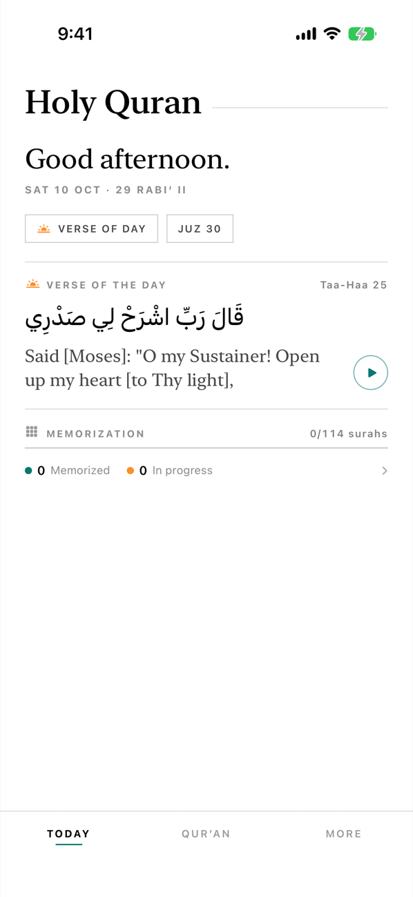
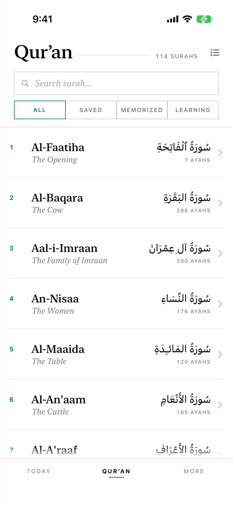
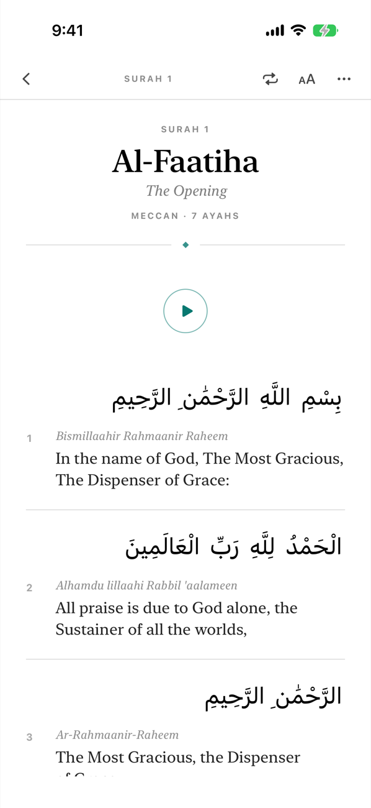
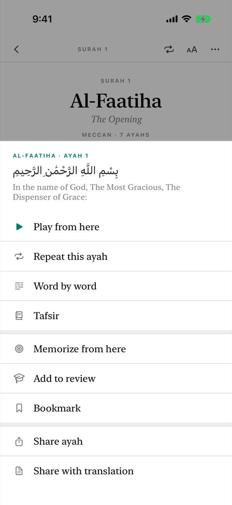
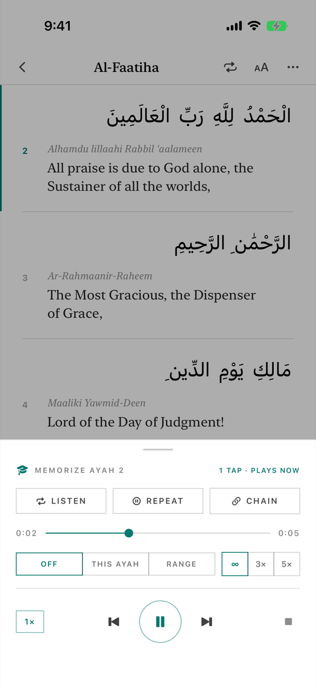
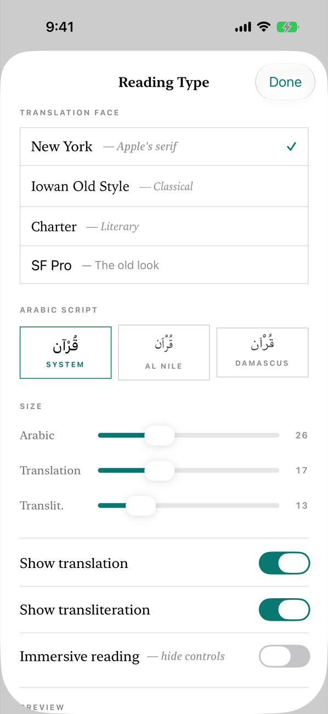
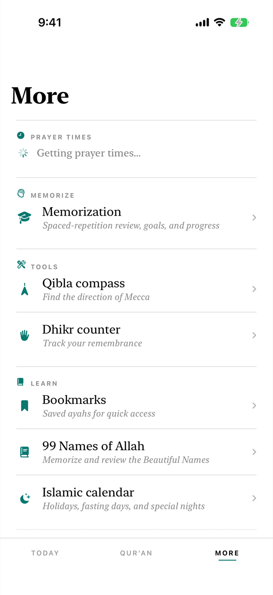
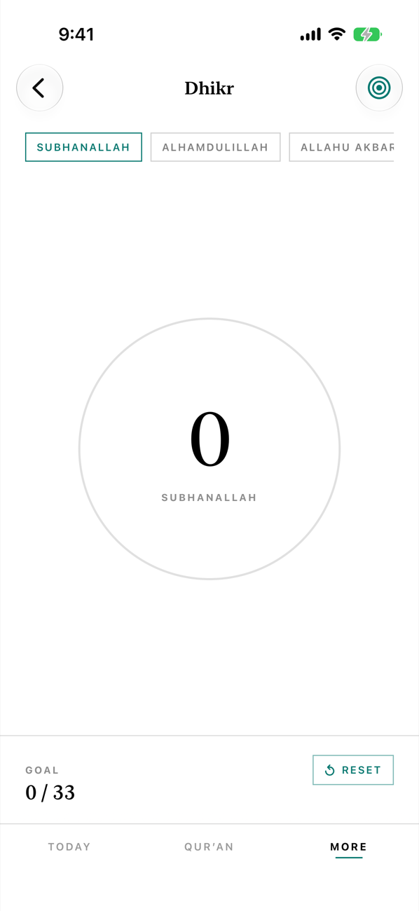

# Holy Quran

An iPhone app for reading, listening to and memorizing the Qur'an, with prayer times and a few daily tools around it.
It's SwiftUI with an editorial design: serif type, plenty of white space, and one teal accent.

  
  
  
  

  
  
  
  

## Features
- **Today:** verse of the day with audio, the Hijri date, the current juz and memorization progress.
- **Reading:** all 114 surahs and a juz browser, with Arabic, transliteration and translation. Typeface, Arabic script
  style and text sizes are adjustable, and there's an immersive mode with no controls.
- **Ayah actions:** play from here, repeat, word by word, tafsir, bookmark and share.
- **Listening:** recitation from several reciters with a mini player, ayah ranges and loops. Surahs can be downloaded
  for offline listening, and audio also plays through CarPlay.
- **Memorization (hifz):** listen, repeat and chain drills for the ayah you're on, plus spaced-repetition review
  of the ayahs you've added.
- **More:** prayer times with a Live Activity countdown, a Qibla compass, a dhikr counter, bookmarks, flashcards for the
  99 Names of Allah, and an Islamic calendar.
- **Widgets and Siri:** a *Holy Quran* widget (next prayer, what you're memorizing, where you left off), a *Memorizing*
  widget, and a "Continue memorizing" shortcut.

## Running it
Open `Quran App.xcodeproj` and run the **Quran App** scheme on an iPhone or simulator running iOS 26 or later.

The **QuranTour** scheme is a UI test that walks through every screen and saves a screenshot of each step to the test
runner's Documents folder. The screenshots above came from it.

## Data sources
- Qur'an text: the [Tanzil Project](https://tanzil.net) (CC BY 3.0), via [alquran.cloud](https://alquran.cloud).
  A bundled `quran_offline.json` covers reading offline, with Pickthall's public-domain English translation.
- Translations and transliteration: [alquran.cloud](https://alquran.cloud). Each translation remains the copyright of
  its translator or publisher.
- Word-by-word data, word timings and tafsir: [quran.com](https://quran.com) (`api.quran.com`, `api.qurancdn.com`).
- Recitation audio: [everyayah.com](https://everyayah.com) and `audio.qurancdn.com`.
- Prayer times: [aladhan.com](https://aladhan.com).

Full credits and license notices are in [CREDITS.md](CREDITS.md).

## Layout
- `Quran App/Models`, `ViewModels`, `Views`, `Services`: the app. `Services` holds the API clients, audio, downloads,
  memorization and review stores, prayer times, Qibla, CarPlay and Siri intents.
- `QuranWidget/`: the widgets, the Control Center control and the prayer Live Activity.
- `QuranTourUITests/`: the screenshot tour.

## License
The code is released under the [MIT License](LICENSE). The Qur'an text, translations, tafsir and audio are not covered
by it. They keep their own terms, listed in [CREDITS.md](CREDITS.md).
