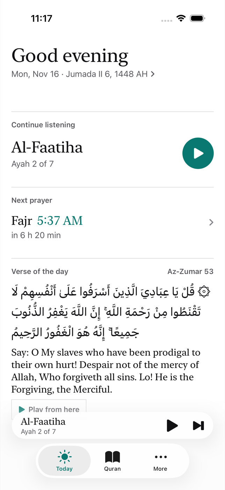
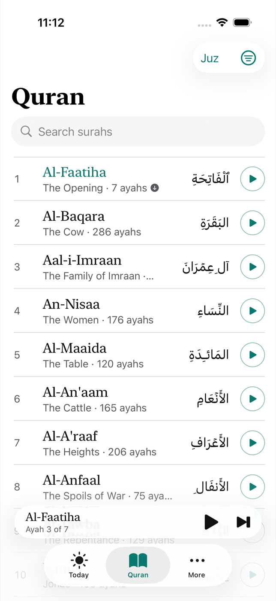
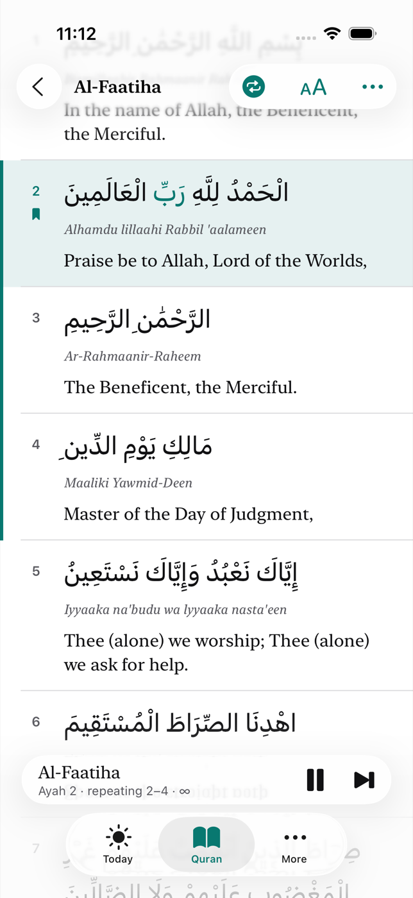
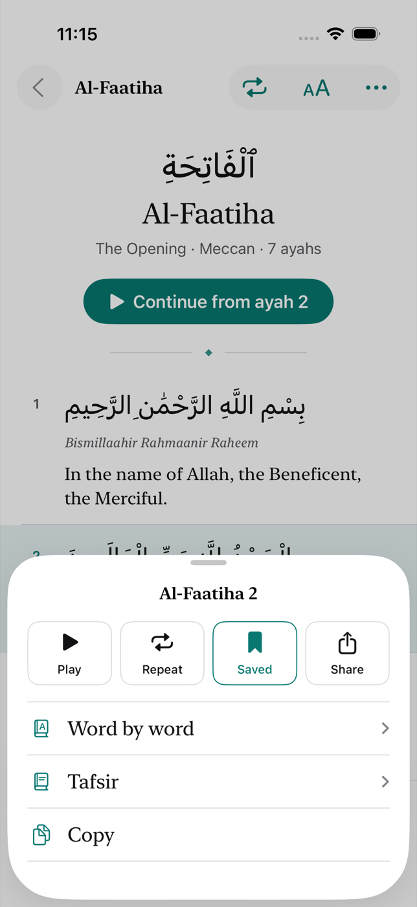
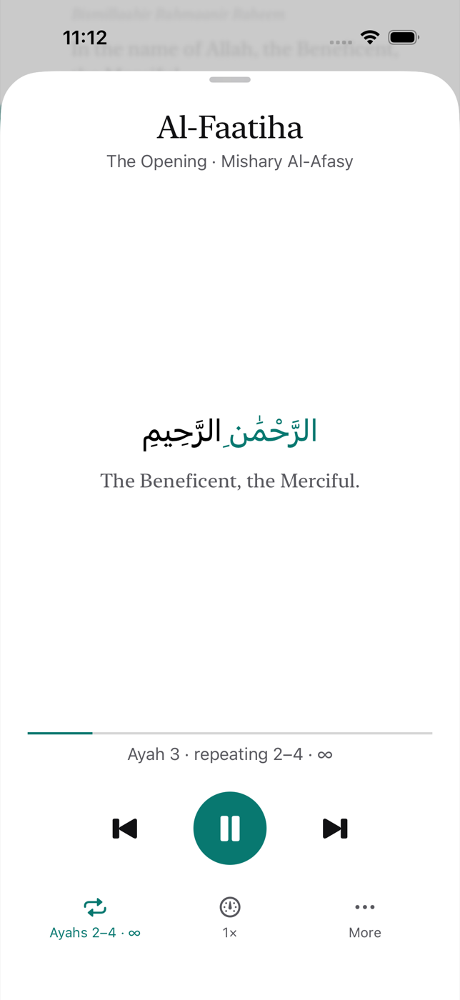
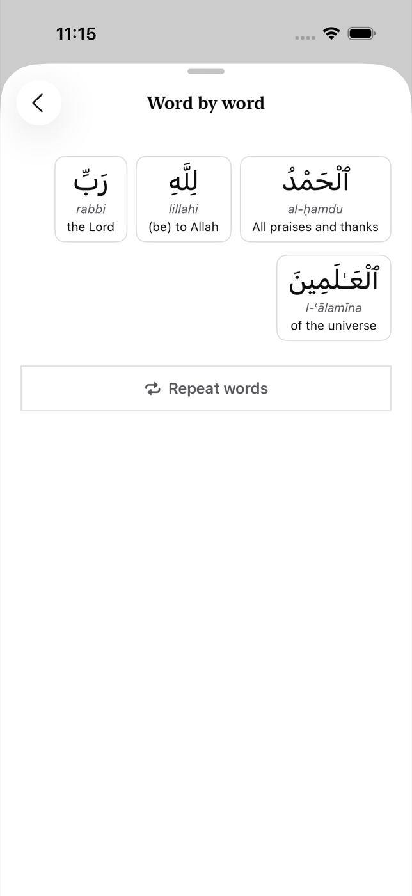
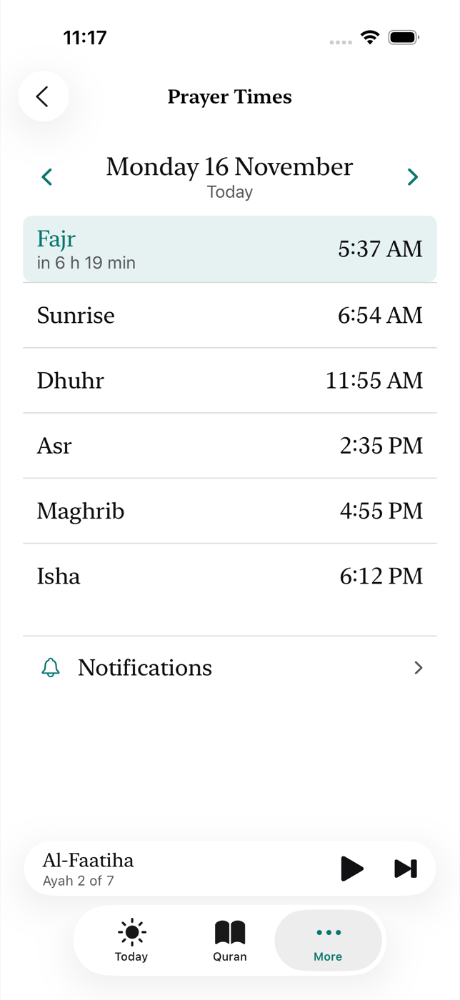
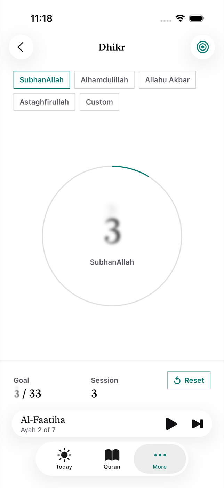

# Quran App

An iPhone app for reading and listening to the Quran, with prayer times and a few daily tools around it.
It's SwiftUI with an editorial design: serif type, plenty of white space, and one accent colour.

  
  
  
  

  
  
  
  

## Features
- **Today:** carry on listening in one tap, the next prayer with a countdown, the Hijri date and a verse of the day.
- **Reading:** all 114 surahs and a juz list, with Arabic, transliteration and translation. Typeface, Arabic script
  style and text sizes are adjustable. The text is bundled, so reading needs no connection.
- **Listening:** one mini player across the app and a Now Playing sheet. The word being recited is highlighted as it
  is said. Seven reciters, four speeds, and an optional pause after each ayah for reciting it back.
- **Repeat:** tap two ayahs and everything between them repeats, until stopped or a set number of times. Word by word
  can repeat a stretch of words inside one ayah.
- **Offline:** every ayah played is kept on the phone and plays from disk after that. Whole surahs can be downloaded
  ahead of time, and other translations are downloaded once, whole.
- **Ayah actions:** play from here, repeat, bookmark, share, word by word, tafsir and copy.
- **More:** prayer times with notifications, a Qibla compass, an Islamic calendar, bookmarks, a dhikr counter and
  flashcards for the 99 Names of Allah.
- **Lock screen:** a widget with the next prayer, its time and a countdown.

## Running it
Open `Quran App.xcodeproj` and run the **Quran App** scheme on an iPhone or simulator running iOS 26 or later.

The **QuranTour** scheme holds the UI tests. `QuranTourUITests` is a smoke test of the core path (launch, play a
surah, tap two ayahs to repeat). `ScreenTourUITests` walks every other screen in light and dark, and checks word
repeat, surah download, translation download and the pause after each ayah. Set `TEST_RUNNER_SHOTS_DIR` to a folder
to have both save a screenshot of each step; the screenshots above came from them.

## How it is built
| File | Role |
|---|---|
| `Services/Player.swift` | The one audio engine. Plays one local file per ayah and decides what follows each one. |
| `Services/AudioStore.swift` | Fetches an ayah's file to disk before it is played; tracks whole-surah downloads. |
| `Services/WordData.swift` | Word timings and word meanings, cached to disk. |
| `Services/QuranText.swift` | The bundled text, and translations downloaded once. |
| `Services/PrayerTimesService.swift` | A month of prayer times per request, cached; feeds notifications and the widget. |
| `Views/RootView.swift` | Tabs, routes and the mini player. Navigation is the system's. |
| `Views/AnimationKit.swift`, `Views/Haptics.swift` | The motion tokens and the haptic vocabulary every screen uses. |

`QuranWidget/` is the lock-screen widget. `docs/` holds the design brief and the audit that led to this version.

## Data sources
- Quran text: the [Tanzil Project](https://tanzil.net) (CC BY 3.0), via [alquran.cloud](https://alquran.cloud).
  A bundled `quran_offline.json` covers reading offline, with Pickthall's public-domain English translation.
- Translations and transliteration: [alquran.cloud](https://alquran.cloud). Each translation remains the copyright of
  its translator or publisher.
- Word-by-word data, word timings and tafsir: [quran.com](https://quran.com) (`api.quran.com`, `api.qurancdn.com`).
- Recitation audio: `verses.quran.com` and `audio.qurancdn.com`, and [everyayah.com](https://everyayah.com) for one
  reciter.
- Prayer times: [aladhan.com](https://aladhan.com). The location sent is rounded to about a kilometre.

Full credits and license notices are in [CREDITS.md](CREDITS.md). The app's privacy policy is in
[PRIVACY.md](PRIVACY.md), and [docs/APP_STORE.md](docs/APP_STORE.md) holds the App Store listing and submission notes.

## License
The code is released under the [MIT License](LICENSE). The Quran text, translations, tafsir and audio are not covered
by it. They keep their own terms, listed in [CREDITS.md](CREDITS.md).
